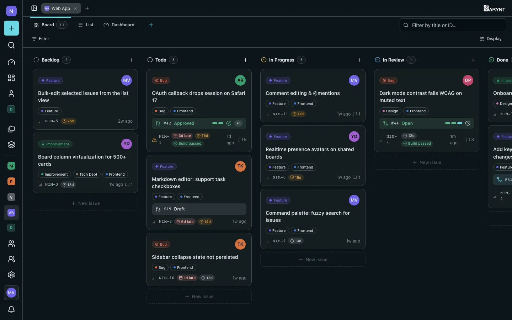
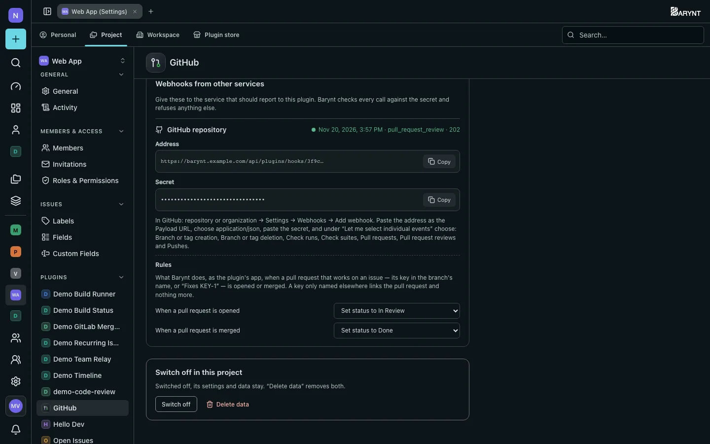
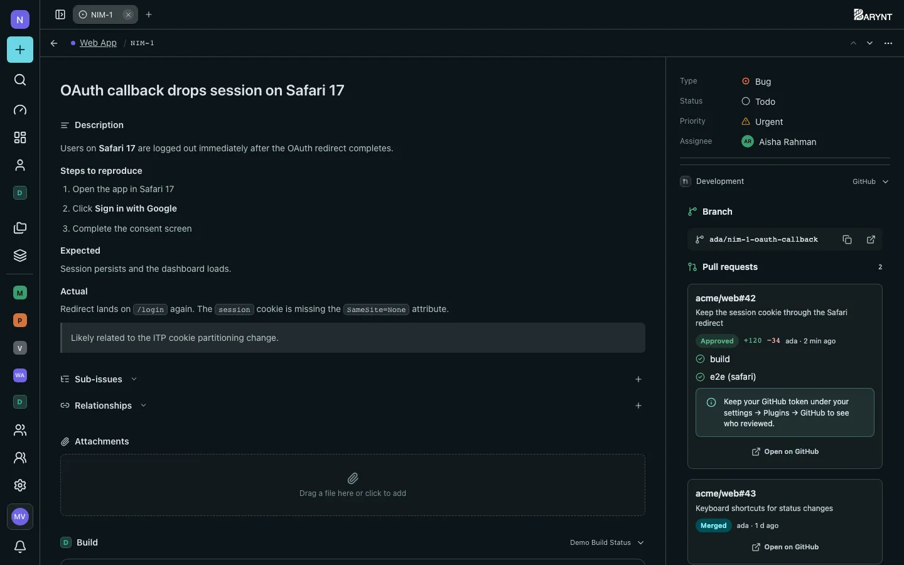

# GitHub for Barynt


Your GitHub work on the issues it's about, in
[Barynt](https://github.com/barynt-dev/barynt-web): every board card shows its
pull request with reviews and checks, the issue gets a **Development** panel
with branch, commits and checks, rules move it to _In Review_ or _Done_ as the
pull request opens and merges, and a branch starts right from the issue.

There's no server to run: Barynt connects through its own GitHub App, reads what GitHub reports and keeps what
they say on the issues; this plugin draws it.



> [!NOTE]
> **0.1.0-beta.3** — a pre-release. It needs Barynt 1.1.0-beta.5 or later.

## On the board

A card whose issue has a pull request shows a row: its number, where it
stands (_Draft_, _Open_, _Changes requested_, _Approved_, _Merged_,
_Closed_), and while it's open, the checks of its branch as bars with the
overall result. With several pull requests, the newest open one and "+n".
The rows of a whole board come from one request to Barynt, never one to
GitHub per card, and change on their own when GitHub reports.

## Set it up

Barynt connects to GitHub through its own **GitHub App** — installed once on
your organization, where you pick the repositories it may see. GitHub then
reports to Barynt by itself: no webhook per repository, no token for the
team.

1. **Admin → Plugins**: install GitHub from the official directory
   ([barynt-plugin-store](https://github.com/barynt-dev/barynt-plugin-store)).
   On its page, the card **GitHub App** creates the instance's app on
   GitHub in one step (or set `GITHUB_APP_*` for one you made yourself).
   Then release it for the workspace.
2. **Workspace settings → Plugins → GitHub → Connect GitHub**: sign in at
   GitHub, install the app on an account and pick its repositories. A
   workspace's connection counts for every project; a project can connect
   an account of its own too.
3. **Project settings → Plugins → GitHub**: confirm what it may do, switch
   it on, and tick the **repositories** the project works with — Barynt
   lists what the connected accounts share.

**Your own token (optional):** a fine-grained token under your personal
settings → Plugins → GitHub (_Contents_ read and write, _Pull requests_ and
_Checks_ read) can put your GitHub login into branch names (`{user}`) and
shows who reviewed. Without it, the plugin works through the connection — on the
ticked repositories only. It's only ever sent to `api.github.com`.

**Without the app:** type the repositories (`owner/repo`, one per line),
add the webhook from the card **Webhooks from other services** in GitHub
(`application/json`, the secret, and the events _Branch or tag creation_,
_Branch or tag deletion_, _Check runs_, _Check suites_, _Pull requests_,
_Pull request reviews_, _Pushes_), and everyone keeps a token.

## Rules



Under the webhook in the plugin's settings, pick a status for each rule,
or leave it off:

- **When a pull request is opened** — e.g. _In Review_
- **When a pull request is merged** — e.g. _Done_

Barynt sets it as "GitHub (App)" and comments why — only for an issue the
pull request works on: its key in the branch's name, or after _Fixes_,
_Closes_ or _Resolves_ in the title or description.

## In the issue



The **Development** panel in the issue's sidebar shows its branch (copy
the name, open it on GitHub), its pull requests with their state, checks,
size and — with your own GitHub token — who reviewed, and the commits that
name it (five, then "Show all"). A click on a card's pull request row opens
the issue there.

## Actions

In an issue's menu ("…"), a card's quick actions and the command palette:

- **Create branch** — in the project's first repository, from its default
  branch, named after the pattern in the settings (`{type}/{key}-{title}`
  by default: `feature/web-42-keep-the-cookie`); a taken name gets `-2`. With
  your own token if you keep one, else through the connection. As the
  project set it,
  the issue is then assigned to you and moved to a status. The panel has
  the same button while the issue has no branch.
- **Copy branch name** — the issue's branch, or the name it would get.
- **Open pull request** — its open pull request, or GitHub's page to open
  one for its branch, the title starting with the issue's key.

## Settings

Under **Project settings → Plugins → GitHub**: the GitHub accounts
connected, the repositories (ticked from what they share), the branch
name's pattern, whether creating a branch assigns
the issue, and which status it gets then.

The branch name's pattern is free to type, or picked from **Suggestions**:

| Suggestion | Pattern | Example |
| --- | --- | --- |
| Type, key and title (default) | `{type}/{key}-{title}` | `feature/web-42-keep-the-cookie` |
| Key and title | `{key}-{title}` | `web-42-keep-the-cookie` |
| Login, key and title | `{user}/{key}-{title}` | `ada/web-42-keep-the-cookie` |
| Type and key | `{type}/{key}` | `feature/web-42` |
| Key only | `{key}` | `web-42` |

`{type}` is `bugfix` for a bug, `chore` for a chore and `feature` for
everything else — the prefixes of the [Conventional Branch](https://conventional-branch.github.io/)
spec. `<type>/<ticket>-<description>` is the most common convention, and
keeps branches sorted by kind. Whatever the pattern, keep `{key}`: it's how
Barynt finds the issue.

The repositories come from the GitHub accounts connected in the workspace
or the project; one that can't be reached any more is marked there. When
the webhook last called is on Barynt's card below the form.

## How issues are found

Barynt looks for the project's issue keys in a pull request's branch,
title and description, in commit messages and branch names: `WEB-42`,
`web-42-fix-login` and `feature/WEB_42` all name WEB-42. Only keys of the
project the plugin is on in count.

## Work on it

The SDK comes from a Barynt checkout next to this folder
(`../barynt/packages/plugin-sdk`):

```bash
(cd ../barynt/packages/plugin-sdk && bun install && bun run build)
bun install
bun run dev        # builds dist/ on every change
bun run test
bun run lint && bun run typecheck
```

In your local Barynt's `.env`: `PLUGIN_DEV_DIRS="/path/to/barynt-plugin-github"`,
then install it under **Admin → Plugins → Sources → Local plugins**.

### Languages

English is the base, German is translated; anything missing stays English.

- What the code draws (panel, settings check, actions' messages):
  `src/i18n.ts`, read with `t("key", { name })`.
- What Barynt shows from the manifest (settings, actions, the panel's title,
  the webhook's rules, the previews): `manifest.json` → `locales.de`, by id.
- The store page: `about.de.md`, and `locales.de.description`.

A new language is another block in both, plus its `about.<lang>.md`.

## Release

`bun run release` builds, copies the files to `release/<version>/`, prints
the release hash and adds the version to `release/plugins.json`. CI does
the same for a pushed tag that matches the manifest's version and creates
the GitHub release.

## Pictures

`logo.png` comes from `assets/logo.svg`, the previews from the screenshots in
`assets/screenshots/`: `bun scripts/images.ts` makes both. The logo is the
pull-request mark of [Lucide](https://lucide.dev) (ISC).
